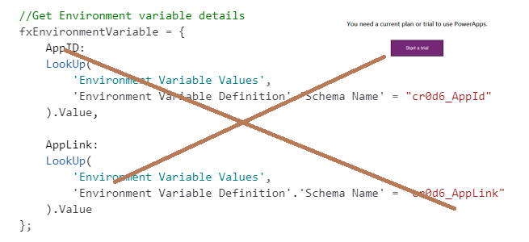
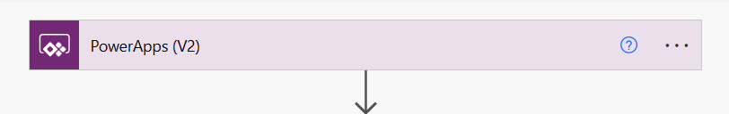
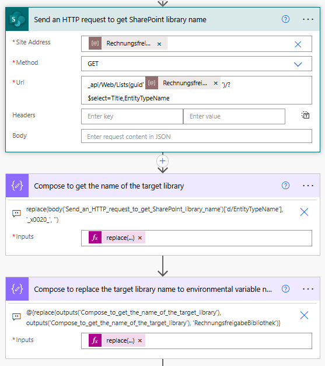
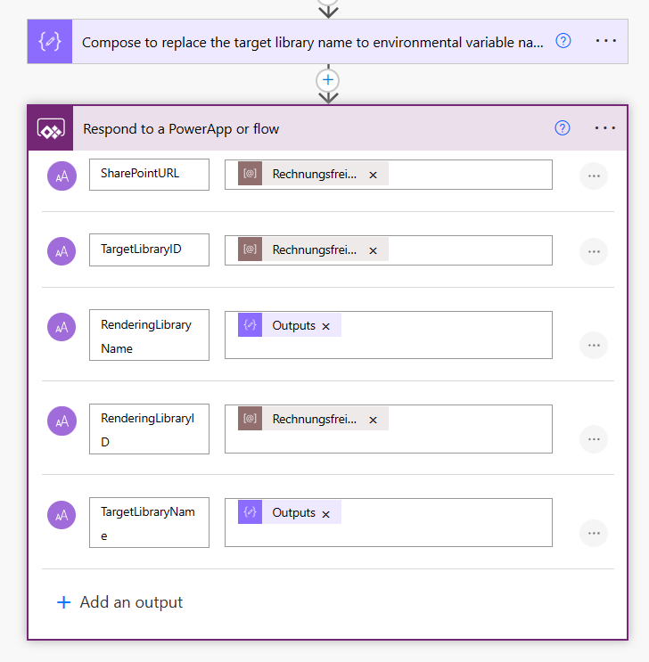
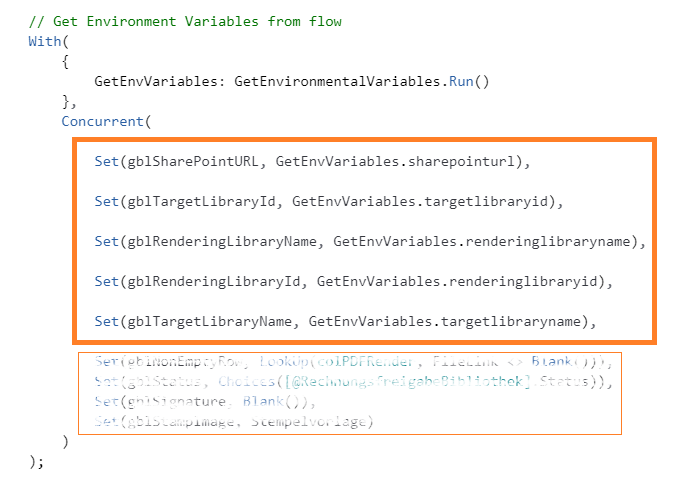

In the realm of PowerApps development, encountering the need to access environment variables without a premium license is a common challenge.

## 🔍 Understanding the Challenge

PowerApps typically require a premium license for accessing environment variables stored in Dataverse tables. However, with this alternative approach utilizing Power Automate, you can bypass the premium license requirement and achieve the desired outcome effectively.

## 💡 Alternative Method: Leveraging Power Automate

Instead of directly accessing environment variables within PowerApps, we’ll utilize Power Automate to fetch variable values and seamlessly integrate them into your PowerApps application.

## 🔧 Implementation Steps

> 1. Create a Flow Triggered from the PowerApp: Ensure it is created within a solution to access environment variables effectively.

> 2. Add a ‘Compose’ Action: Use this action to store the desired environment variable and send the value back to the PowerApp.

⚙️ Note: The ‘Compose’ step is crucial for the solution’s functionality.

## 🏃‍♂️ Executing the Flow

Once the flow is set, integrate it into the PowerApp. Utilize the OnStart property to run it and store the environment variable into a PowerApp variable.

## 🏁 Conclusion

By leveraging Power Automate as an intermediary for fetching environment variable values, you can bypass the premium license requirement in PowerApps. This alternative method provides a seamless integration between Power Automate and PowerApps, allowing you to effectively access and utilize environment variables without constraints.
