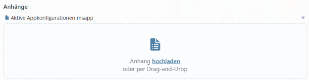
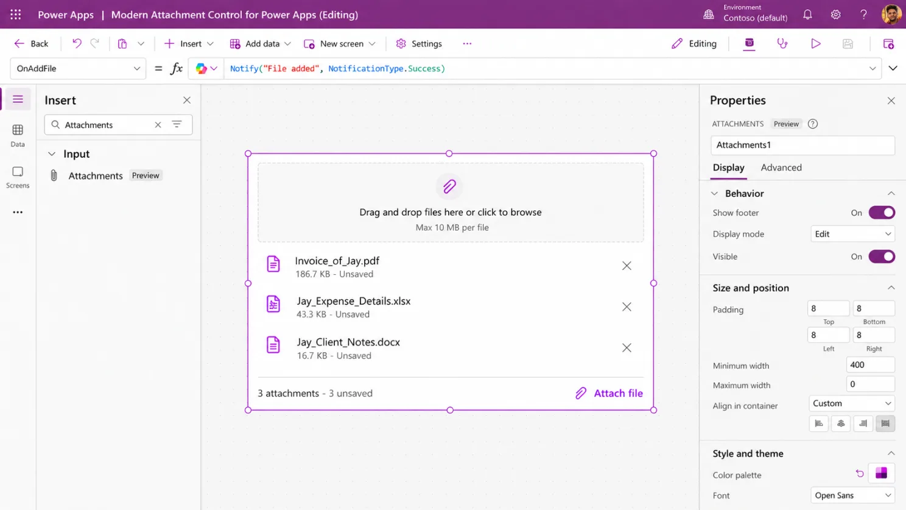
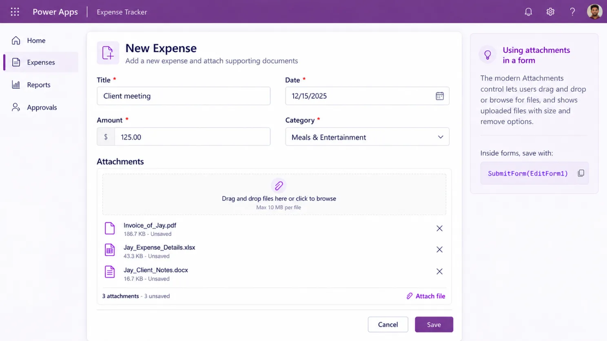

### And yes… we can finally Patch attachments directly.

If you've built enough Canvas Apps, you probably know the attachment-control struggle.

You need users to upload a receipt, document, invoice, or supporting file.

Sounds simple.

Then you remember:

> “Ah… the Attachments control.” 😅

For years, attachments in Canvas Apps have been one of those things that technically worked - but often required much more effort than the requirement itself suggested.

And Microsoft has just made this experience much more interesting.

We now have a **Modern Attachments control for Canvas Apps**, currently in Preview.

And the feature that immediately caught my attention is this:

🔥 **It can work outside a form, and its attachments can be saved directly using** Patch.

Microsoft specifically documents that the modern control can work independently of a form and that its Attachments output can be passed directly to Patch. [Microsoft Learn](https://learn.microsoft.com/en-us/power-apps/maker/canvas-apps/controls/modern-controls/modern-control-attachments)

That is a pretty big deal.

---

## Why am I so interested in this?

Because at **Power Doc 365**, we've dealt with the alternative. 😄

In one of our Canvas Apps for **travel expense management**, users needed to upload receipts together with their expense entries.

The requirement sounded simple:

**“Allow the user to attach a receipt.”**

But we wanted a better user experience than simply depending on the traditional attachment experience inside a form.

So we built our own reusable attachment solution.

We had a custom component called:

cmpDragDropFile

Behind that nice UI was quite a bit happening.



We maintained uploaded files in:

colFiles

We had:

- reset logic
- remove logic
- file-size validation
- file-type validation
- error handling
- separate receipt collections such as colBeleges
- logic for deleting files from Dataverse as well as from the local app state

And when users moved between records, we had to carefully differentiate between files that were already saved and files that existed only temporarily inside the app. That's exactly the kind of additional plumbing described in the earlier implementation notes for this post. Pasted text

The result worked.

Actually, it worked really well.

But that's the point.

Something as normal as:

**“Please attach your receipt.”**

required a surprising amount of engineering.

---

## And it wasn't just one Power Doc 365 app

We've seen similar patterns elsewhere in the Canvas Apps we build at **Power Doc 365**.

In another solution, receipt information had to be transformed into something like:

```powerfx
{
    FileName: ...,
    Value: ...
}
```

before we could work with it the way the application required.

Again, completely possible.

Power Apps gave us enough flexibility to solve it.

But there was always this additional layer sitting between:

**User selects a file**

⬇️

Collections / component logic / validation

⬇️

File conversion

⬇️

Save logic

⬇️

**File actually reaches the data source**

The Modern Attachments control starts removing some of that plumbing.

And I'm very happy about that. 😄

---

## This isn't just the classic control with rounded corners

When I first saw “Modern Attachments control”, I wondered whether this was mostly going to be a UI refresh.

Fortunately, no.

There are some genuinely useful changes.

### 1️⃣ It can finally work outside a form

This is probably my favourite improvement.

Historically, attachment upload/delete behaviour was heavily associated with forms.

Now the control can be placed independently in your custom UI.

Think about the layouts many of us actually build:

**Gallery on the left**

➡️ **Details on the right**

➡️ **Attachments underneath**

➡️ **Save button**

No form gymnastics just because one area of the application needs file upload functionality.


Microsoft now explicitly supports this standalone scenario. [Microsoft Learn](https://learn.microsoft.com/en-us/power-apps/maker/canvas-apps/controls/modern-controls/modern-control-attachments)

---

## A simple example

Let's use an **Expense Management App**, because this is very close to scenarios we've already worked on at Power Doc 365.

Suppose we have a SharePoint list:

```powerfx
Expenses
```

A gallery:

```powerfx
galExpenses
```

And the new modern Attachments control:

```powerfx
attReceipts
```

To display the selected expense's attachments:

```powerfx
galExpenses.Selected.Attachments
```

The user can now:

📎 Add another receipt

🗑️ Remove an attachment

📥 Open/download an existing file

🖱️ Drag files directly onto the control on the web

And then comes my favourite part.

Our Save button can use:

```powerfx
Patch(
    Expenses,
    galExpenses.Selected,
    {
        Attachments: attReceipts.Attachments
    }
)
```

That's it.

No hidden form.

No custom upload workaround.

No intermediate form submission just to deal with attachments.

The Attachments output is passed directly to the SharePoint attachment column. Microsoft documents this exact standalone Patch pattern. [Microsoft Learn](https://learn.microsoft.com/en-us/power-apps/maker/canvas-apps/controls/modern-controls/modern-control-attachments)

Now compare that with some of the things we've historically had to build:

**Custom component**

→ collection management

→ attachment-control workaround

→ added/removed file tracking

→ save handling

→ reset handling

→ validation

→ error states

You can probably understand why this update made me smile. 😄

---

## Drag & Drop 👋

This is another nice improvement.



On the web, users can drag files directly onto the control.

On mobile, Power Apps uses the device's file picker instead. [Microsoft Learn](https://learn.microsoft.com/en-us/power-apps/maker/canvas-apps/controls/modern-controls/modern-control-attachments)

For the type of document-heavy business applications we often build at **Power Doc 365**, this may look like a small improvement from the developer side…

…but it's exactly the kind of small UX improvement users notice immediately.

Think about:

📄 Purchase requests

🧾 Expense receipts

📑 Invoices

👤 HR documents

📁 Project documents

✅ Approval supporting documents

📷 Evidence uploads

Drag.

Drop.

Continue.

Much nicer.

---

## Accepted file types are built in

Here's another feature I'm very happy to see.

We can configure:

```powerfx
AcceptedFileTypes
```

For example:

```json
[".pdf", ".docx"]
```

The control can then restrict newly added files to the extensions we've allowed. Microsoft also notes that this doesn't replace the validation and policies enforced by the underlying data source. [Microsoft Learn](https://learn.microsoft.com/en-us/power-apps/maker/canvas-apps/controls/modern-controls/modern-control-attachments)

Previously, this was another thing we often had to handle ourselves:

Get filename.

Check extension.

Set error variable.

Show validation message.

Remove/reset invalid attachment.

Repeat.

Now much of that behaviour belongs where it should:

**inside the attachment control itself.** 👏

---

## We also get proper events

The control gives us:

```powerfx
OnAddFile
OnRemoveFile
OnSelect
OnError
```

And useful outputs including:

```powerfx
Attachments
AttachmentsCount
IsUploading
```

One detail worth knowing:

OnAddFile runs **once for every file added**, not once for the entire batch. [Microsoft Learn](https://learn.microsoft.com/en-us/power-apps/maker/canvas-apps/controls/modern-controls/modern-control-attachments)

That opens up some nice possibilities:

✅ custom notifications

✅ logging

✅ UI state updates

✅ additional validation

✅ file-specific actions

✅ telemetry

And probably a few creative things Power Apps makers will discover that Microsoft didn't expect. 😄

---

## What about Modern Forms?

Good news there too.



If you're using a Modern Form, the modern Attachments control can live directly inside the Attachments data card.

Then your normal:

```powerfx
SubmitForm(EditForm1)
```

can save the record together with its attachments. [Microsoft Learn](https://learn.microsoft.com/en-us/power-apps/maker/canvas-apps/controls/modern-controls/modern-control-attachments)

So we now have two very clean patterns.

### Form-based apps

```powerfx
SubmitForm(...)
```

### Custom Canvas UI

```powerfx
Patch(...)
```

That second option is the one I'm personally most interested in.

A lot of the enterprise Canvas Apps we build at **Power Doc 365** aren't just forms dropped onto screens.

We're usually working with:

- responsive containers
- galleries
- reusable components
- role-based interfaces
- dedicated save logic
- custom validation
- Dataverse and SharePoint
- Power Automate integrations

Having attachments finally fit naturally into that architecture is a very welcome change.

---

## One important thing though ⚠️

When you add a file to the Modern Attachments control, **it hasn't necessarily been saved yet**.

The file is initially staged in the app.

You still need to persist the changes using:

```powerfx
Patch(...)
```

or

```powerfx
SubmitForm(...)
```

Microsoft also points out that IsUploading tells you whether files are being added to the control's in-memory state - it doesn't mean your data-source save has completed successfully. [Microsoft Learn](https://learn.microsoft.com/en-us/power-apps/maker/canvas-apps/controls/modern-controls/modern-control-attachments)

That's important when designing:

**Save**

**Cancel**

and especially:

**record navigation**

For example:

User edits attachments for Expense A.

Then clicks Expense B.

What happens to those unsaved changes?

That's still our responsibility as app makers.

The control simplifies attachment handling.

It doesn't eliminate application design. 😉

---

## And no… it doesn't magically remove backend limits 😄

If we configure:

```powerfx
MaxAttachmentSize = 100
```

that doesn't magically convince SharePoint or Dataverse to accept something the underlying data source doesn't support.

Control-level limits and data-source limits are separate concerns. [Microsoft Learn](https://learn.microsoft.com/en-us/power-apps/maker/canvas-apps/controls/modern-controls/modern-control-attachments)

There's also an important Dataverse distinction.

A **Dataverse File column** stores one file.

That's different from the record attachment experience.

For a File column, we'll still construct something like:

```powerfx
{
    FileName: First(FileUpload1.Attachments).Name,
    Value: First(FileUpload1.Attachments).Value
}
```

rather than passing the entire Attachments table. [Microsoft Learn](https://learn.microsoft.com/en-us/power-apps/maker/canvas-apps/controls/modern-controls/modern-control-attachments)

So yes…

The Modern Attachments control makes life easier.

It doesn't make the underlying data model disappear. 😉

---

## Classic vs Modern Attachments

For me, this is the difference.

### Before 😅

📎 Classic attachment control

📋 Often associated with form behaviour

🧩 Custom components for better UX

🗃️ Collections for temporary file management

⚠️ Custom file validation

🔄 Reset/remove state management

🧠 Lots of Power Fx keeping everything synchronized

### Now 🚀

📎 Modern themed control

🖱️ Drag & drop on web

📁 Accepted file types

🔢 Attachment count

📏 File size/count configuration

⚡ Per-file events

🧩 Works outside a form

🔥 Attachments output usable directly with Patch

That's not just a visual refresh.

That's a meaningful maker experience improvement.

---

## My favourite part?

It isn't actually the modern UI.

It isn't even drag and drop.

It's this:

> We can stop building so much infrastructure around a completely normal business requirement.

When you're building Power Platform solutions every day, sometimes the best new feature isn't one that suddenly lets you build something impossible.

Sometimes it's a feature that lets you delete a bunch of clever code you were previously quite proud of. 😂

And from some of the attachment components we've built at **Power Doc 365**…

I can already hear a few of them getting nervous. 😄

---

## One last thing: it's still Preview ⚠️

The Modern Attachments control is currently a **Preview feature**.

Microsoft explicitly says Preview features aren't intended for production use and may still have restricted functionality or change before general availability. [Microsoft Learn](https://learn.microsoft.com/en-us/power-apps/maker/canvas-apps/controls/modern-controls/modern-control-attachments)

So no…

I'm not going to start replacing attachment components across every Power Doc 365 production app tomorrow morning. 😄

But I absolutely want to test:

✅ Standalone Patch()

✅ SharePoint attachments

✅ Dataverse attachments

✅ Dataverse File columns

✅ Drag & drop

✅ Accepted file types

✅ File-size validation

✅ Mobile behaviour

✅ Error handling

✅ Unsaved navigation scenarios

✅ Whether some of our existing reusable attachment components can eventually be retired

This is exactly the kind of Preview feature worth putting into a test Canvas App and experimenting with.

---

### Power Apps makers - how have you been handling attachments until now?

Classic forms?

Hidden forms? 👀

Custom components?

Collections?

Power Automate?

Or some attachment workaround so creative that you don't want to admit it publicly? 😂

I'd genuinely like to know.

**From my side, I'll definitely be keeping an eye on this one - and testing where it could simplify the Canvas Apps we're building at Power Doc 365.**

[Sibiraj Sampasivam](https://www.linkedin.com/in/sibiraj-sampasivam-72522899/) [Joana Schröter](https://www.linkedin.com/in/joana-schr%C3%B6ter/) [Arun V R](https://www.linkedin.com/in/arun-v-r-3bb975215/) [Kiruthika Senthilkumar](https://www.linkedin.com/in/kiruthika-senthilkumar-ab8040252/) [Akshay Sarda](https://www.linkedin.com/in/akshayrsarda/) [Alexander Strakbein](https://www.linkedin.com/in/alexander-strakbein-70990b1a0/)

#PowerApps #PowerPlatform #MicrosoftPowerPlatform #CanvasApps #PowerFx #Dataverse #SharePoint #PowerAutomate #LowCode #PowerDoc365 #PD365
