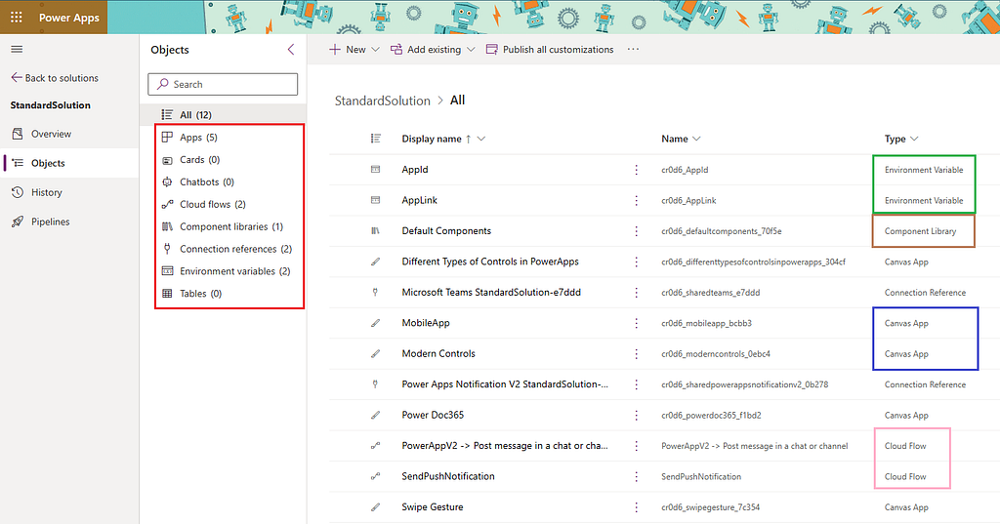
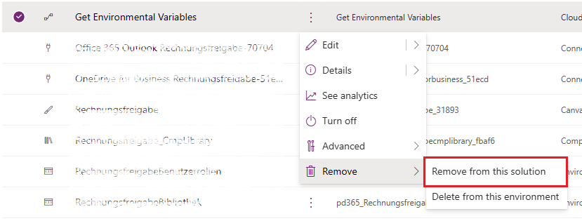
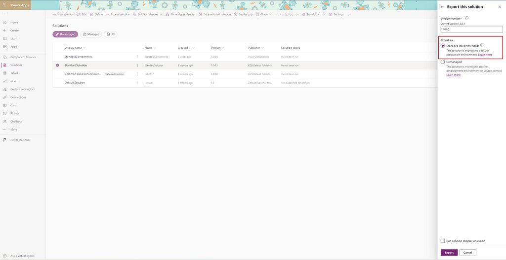

In this post, we’ll unveil the ultimate checklist for ensuring the seamless rollout of our PowerApps solutions. Just like a skilled architect meticulously plans every detail before constructing a magnificent castle, we’ll equip with the tools and knowledge to build and deploy our PowerApps empire with confidence.

**Build our PowerApps Empire within a Solution 🏰:**

Picture this: We’re crafting a PowerApp masterpiece, complete with all the bells and whistles. But wait! Before we launch it into the digital universe, ensure everything, from apps to flows, resides snugly within a single solution. It’s like building a castle with all its components in one place, ready to conquer new territories.

**Before exporting the solution, go into the properties of the environment variables and remove the current default value. It’s important to do this from the solution, not from the environment.**

Before we set sail on our PowerApps deployment journey, there’s a crucial step to ensure smooth sailing: removing default values from environment variables. This meticulous attention to detail ensures that our PowerApps deployment sails smoothly, avoiding any unexpected conflicts or misconfigurations during the exportation process. By stripping away default values directly from the solution itself, we pave the way for our PowerApps’s triumphant voyage to its new habitat. With this meticulous attention to detail, our PowerApp empire will stand firm and resilient against any deployment challenges that may arise. 🛳️🔑

**Exporting Solutions: our PowerApps Passport ✈️:**

Time to pack our bags and export our solution as a managed entity. This ensures our PowerApp adventure remains intact as our journey from one environment to another. Just like having a trusty passport, this exportation process ensures smooth transitions across different realms.

**Data Source Consistency: The Backbone of our PowerApp Kingdom 🏰:**

In our quest for data sovereignty, maintain consistency in our data sources between environments. Whether it’s SharePoint or SQL, keeping table and field names unchanged ensures our PowerApp kingdom’s stability. It’s like maintaining the integrity of our kingdom’s backbone, ensuring everything stands tall and strong.

**Harnessing Environmental Variables: our PowerApp Spell book 📜:**

Environmental variables are the incantations that breathe life into our PowerApps. Collect and prepare them diligently, much like gathering ingredients for a potent potion. From SharePoint IDs to folder paths, each variable holds the key to unlocking our PowerApps’s full potential in its new environment.

**Importing and Connecting: Unleash our PowerApps Magic 🪄:**

It’s time to wave our wand and import our solution into the target environment. Ensure every environmental variable is connected correctly, like aligning stars in the night sky. This step ensures our PowerApp magic flows seamlessly in its new habitat.

**Sharing our PowerApp Marvel: Empowering our Allies 🌟:**

With our PowerApp deployed, it’s time to share its wonders with our allies. Whether We’re assigning individual users or whole security groups, empower them with access to our creation. Think of it as distributing magical artifacts to those worthy of wielding their power.

**Conclusion:**\
Embark on our PowerApp journey armed with this checklist and watch as our digital kingdom thrives and conquers new frontiers! With careful planning and execution, our PowerApps solutions will stand as testaments to our mastery of deployment techniques. Here’s to conquering new realms and unlocking the full potential of PowerApps! 🌍✨
