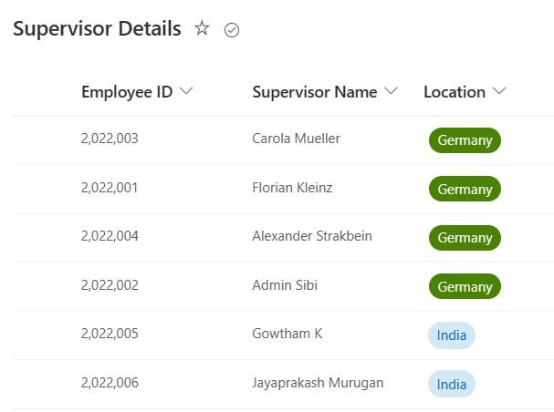
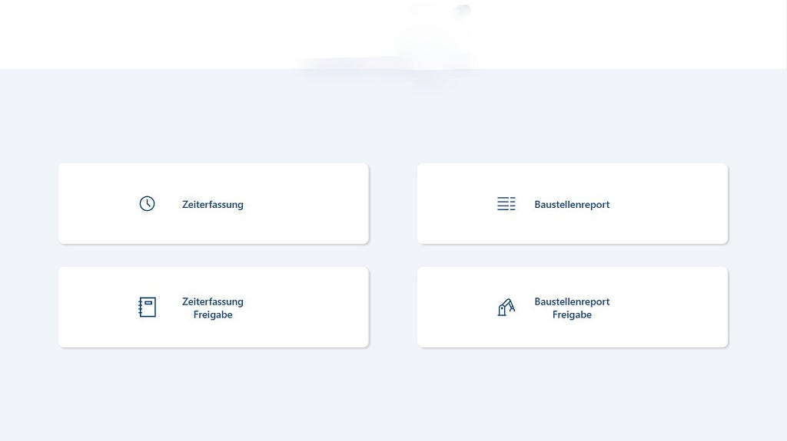
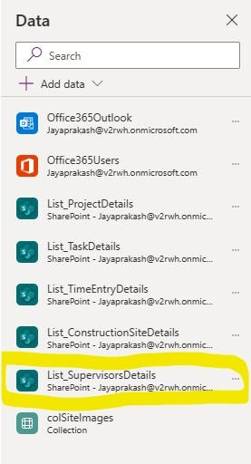
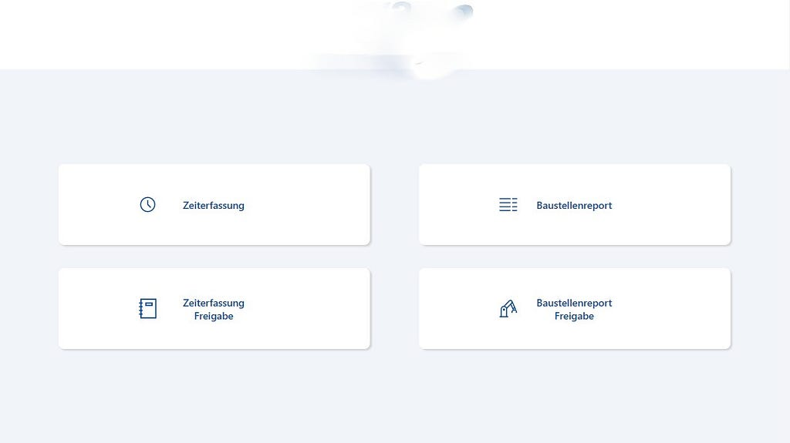
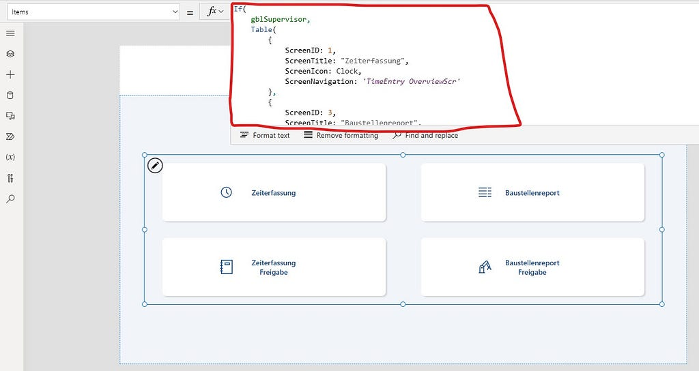
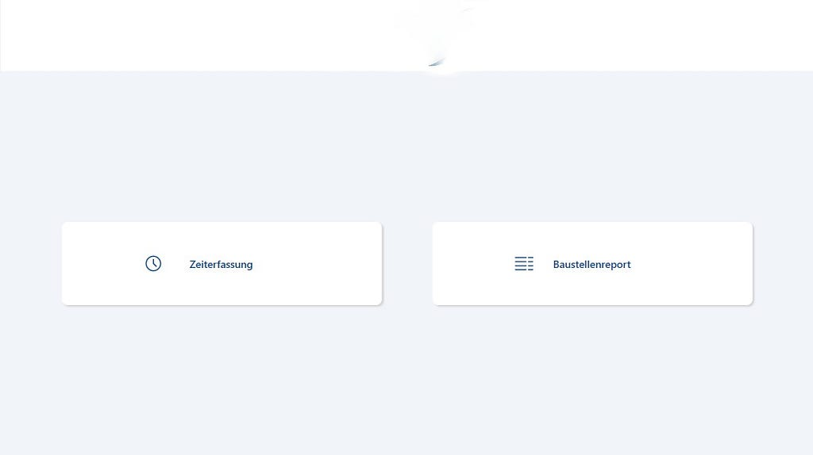

## Introduction

In this Post, we will explore how to implement role-based security in PowerApps using SharePoint. Role-based security is essential for controlling access to specific data or functionalities within your PowerApps applications. We will walk through an example of using SharePoint lists to manage role-based access and demonstrate how to create a PowerApps gallery with dynamic visibility based on user roles.

## 📋 Setting Up SharePoint Lists

To begin, we need to establish SharePoint lists to manage user roles and access. For our example, we have created two SharePoint lists: “Supervisor Details” with the following columns:

1. **Supervisor Name (person field)**
2. **Location (Text field)**
3. **Employee ID (Text field)**

In these lists, you can add the supervisors whose role grants them access to specific data or functionality in your PowerApps application. By adding users’ email addresses to the “Supervisor Details” list, we designate them as supervisors.



## 📱 PowerApps Gallery with Role-Based Security

In our scenario, we have a PowerApps gallery that needs role-based security. The gallery displays data, and we want supervisors to see all fields while non-supervisors (end-users) should only see specific fields.



### ⚙️ Connecting SharePoint List Data

First, we need to connect our PowerApps application to the “Supervisor Details” SharePoint list, where we store supervisor information.



Additionally, we’ll set up the PowerApps OnStart property to determine if the user is a supervisor using the following code:

```powerfx
// Set the current logged-in user details
Set(gblUserEmail, User().Email);

// Check if the logged-in user is a supervisor
Set(
    gblSupervisor,
    !IsBlank(
        LookUp(
            List_SupervisorsDetails,
            'Supervisor Name'.Email = gblUserEmail
        )
    )
);
```

### 🗺️ Creating a Navigation Gallery

We’ve created a navigation gallery with various items. Depending on whether a user is a supervisor or not, certain items should be visible or hidden.



Here’s an example of how to set the visibility of specific items based on the user’s role:

```powerfx
If(
    gblSupervisor,
    Table(
        {
            ScreenID: 1,
            ScreenTitle: "Zeiterfassung",
            ScreenIcon: Icon.Clock,
            ScreenNavigation: 'TimeEntry OverviewScr'
        },
        {
            ScreenID: 3,
            ScreenTitle: "Baustellenreport",
            ScreenIcon: Icon.DetailList,
            ScreenNavigation: 'ConstructionSiteReport OverviewScr'
        },
        {
            ScreenID: 2,
            ScreenTitle: "Zeiterfassung Freigabe",
            ScreenIcon: Icon.Notebook,
            ScreenNavigation: 'TimeEntry OverviewScr'
        },
        {
            ScreenID: 4,
            ScreenTitle: "Baustellenreport Freigabe",
            ScreenIcon: Icon.Manufacture,
            ScreenNavigation: 'ConstructionSiteReport OverviewScr'
        }
    ),
    Table(
        {
            ScreenID: 1,
            ScreenTitle: "Zeiterfassung",
            ScreenIcon: Icon.Clock,
            ScreenNavigation: 'TimeEntry OverviewScr'
        },
        {
            ScreenID: 3,
            ScreenTitle: "Baustellenreport",
            ScreenIcon: Icon.DetailList,
            ScreenNavigation: 'ConstructionSiteReport OverviewScr'
        }
    )
)
```

In this formula, gblSupervisor is a variable that checks if the logged-in user is a supervisor or not.



Depending on the result, the navigation items will either be visible or hidden.



## 🎯 Conclusion

This approach to role-based security in PowerApps using SharePoint provides a flexible solution to manage access control in your applications. By implementing this methodology, you can ensure that users who are designated as supervisors have access to all relevant data and functionality, while non-supervisors are restricted to specific information.

This method can be adapted to suit various role-based security requirements in your PowerApps projects, offering a robust way to control access and maintain data privacy.

In this post, we have demonstrated how to implement PowerApps role-based security with SharePoint using a gallery, where users presented in the SharePoint list can view all fields, and other users can view a limited subset of fields.
