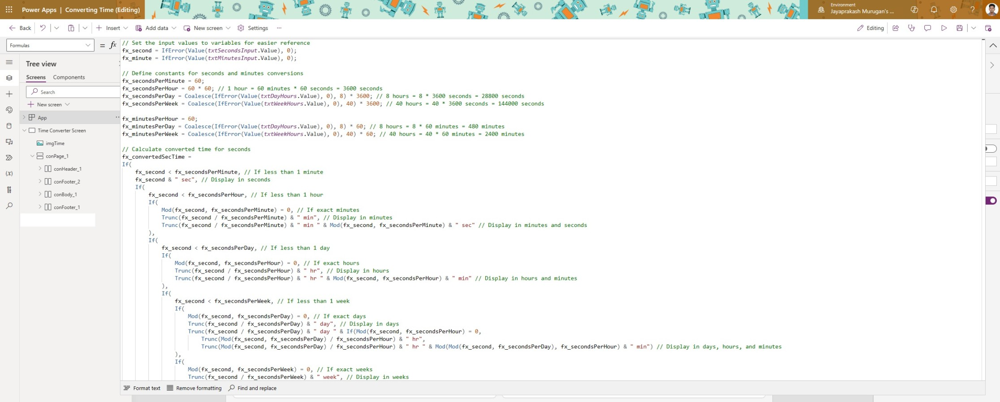

**Introduction:**

Time is a currency we all trade in, and in the realm of app development, managing it effectively is paramount. In this article, we'll embark on a journey through the intricate world of time conversion within PowerApps, Microsoft's low-code platform. We'll unravel the complexities of handling seconds and minutes, equipping you with the tools to create apps that seamlessly manage time. Let's dive in!

**Understanding the Code:**

Let's dissect the provided PowerApps code, piece by piece, to comprehend its functionality and versatility.

*Used formulas section to set all varible*

1. **Input Values and Constants:**

- 📊 The code initializes input values for seconds (`fx_second`) and minutes (`fx_minute`) from text input controls.

- ⏳ Constants for conversions like fx_secondsPerMinute, fx_secondsPerHour, and others are defined for precise calculations.

2. **Time Conversion for Seconds (`fx_convertedSecTime`):**

- 🕒 The code intelligently converts seconds into minutes, hours, days, and even weeks.

- 📅 It ensures accurate conversions, catering to various scenarios where time spans beyond conventional units.

3. **Time Conversion for Minutes (`fx_convertedMinTime`):**

- 🕐 Similar to seconds, this section handles minute conversions with finesse.

- 🔄 It elegantly transforms minutes into hours, days, and weeks, adapting to diverse input ranges.

**Use Case: The Employee Scheduler App 🗓️**

Imagine you're developing an employee scheduling app using PowerApps. Here's how our time conversion code comes into play:

👩💼 **Input Scenario 1:**

- An employee needs to log a task lasting 2700 seconds.

- Using our PowerApps code, the input is transformed into "45 min" for clear readability.

👨💼 **Input Scenario 2:**

- Another employee enters a project duration of 540 minutes.

- The app dynamically converts this to "9 hrs" or "1 day 1 hr," depending on the duration, providing users with a comprehensive view of their schedules.

**Conclusion:**

By unraveling the intricacies of time conversion in PowerApps and applying them to real-world scenarios like our Employee Scheduler App, we've unlocked a world of possibilities. 🚀 Whether you're crafting productivity tools, scheduling apps, or time management solutions, mastering these techniques is essential.

**Call to Action:**

🛠️ Dive into your PowerApps projects armed with the knowledge gained from this article. Experiment with time conversions, explore new use cases, and share your experiences and insights in the comments below.

Remember, time is of the essence, and with PowerApps, you have the power to make every moment count. 🚀
